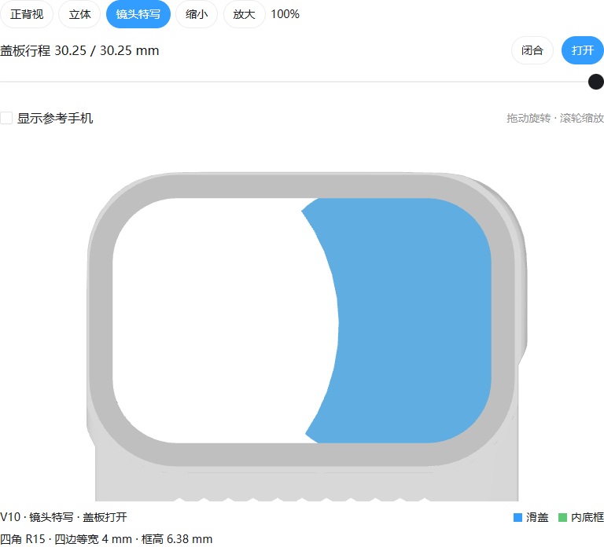
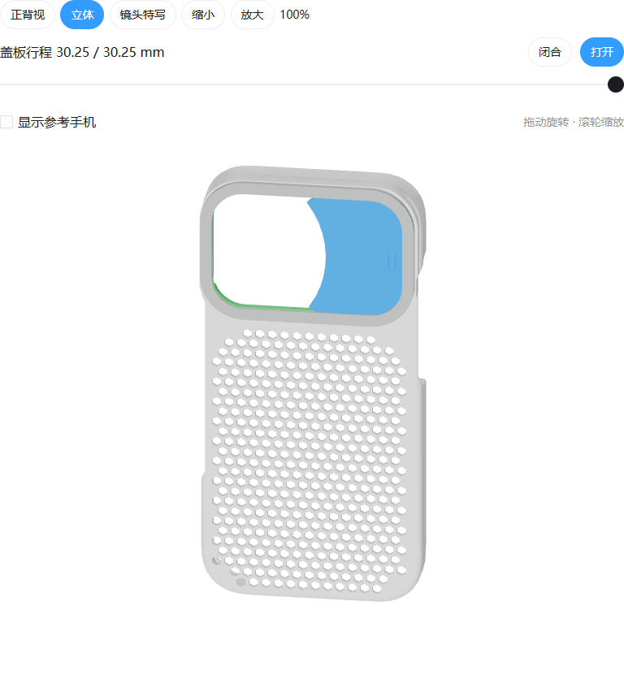

# iPhone 16 Pro 滑盖手机壳 · V10

四个 PLA 打印件组成的免螺钉手机壳：壳体、内底框、外压框、左右滑动的月牙盖板。本分支保存已检查的 **V10 成果快照**。

**[下载完整 V10 四件套 ZIP](downloads/camera-slide-v10-uniform-frame.zip?raw=true)** · [设计与装配说明](v10/设计说明.txt) · [文件校验清单](v10/package_manifest.json)

## 设计

- 外压框为闭合圆角矩形：四个外圆角 R15 mm、内圆角 R11 mm、四边等宽 4 mm。
- 滑盖行程 30.25 mm；以不超出壳体投影为优先，左侧保留月牙缺口。
- 内底框从手机侧装入，外压框从背面以四个卡扣固定。
- 导槽和硬限位藏在两层框之间，开、关两端采用一体弹舌定位。
- 框顶距参考手机背玻璃 6.38 mm；盖板厚 0.8 mm，隐藏导槽局部顶厚 0.38 mm。
- 下方 391 个蜂窝孔与镜头框中心对齐。

## 打印文件

V10 四件需配套使用。下列 STL 是独立打印件，对应 STEP 可在 CAD 软件中继续编辑。

| 零件 | STL | STEP |
| --- | --- | --- |
| 手机壳 | [modified_case.stl](v10/modified_case.stl) | [modified_case.step](v10/modified_case.step) |
| 内底框 | [insert_base.stl](v10/insert_base.stl) | [insert_base.step](v10/insert_base.step) |
| 外压框 | [upper_bezel.stl](v10/upper_bezel.stl) | [upper_bezel.step](v10/upper_bezel.step) |
| 滑盖 | [moving_cover.stl](v10/moving_cover.stl) | [moving_cover.step](v10/moving_cover.step) |

内底框平放；外压框 STL 已按外表面朝下放到 Z=0；滑盖 STL 按手机侧朝下放到 Z=0、导鞋朝上。手机壳需在切片软件中贴合平台。检查薄槽顶、导鞋和弹舌根部是否连续成形，先试印两框与滑盖确认 PLA 配合。

装配顺序：取下手机 → 从内侧装入底框 → 放入全关位置的滑盖 → 对正外压框并均匀扣合 → 检查滑动、定位后装手机。详细拆装方向见[设计说明](v10/设计说明.txt)。

## 装配查看

| 状态 | 四件装配 | 带参考手机 |
| --- | --- | --- |
| 关闭 | [assembly_closed.step](v10/assembly_closed.step) | [assembly_phone_closed.step](v10/assembly_phone_closed.step) |
| 打开 | [assembly_open.step](v10/assembly_open.step) | [assembly_phone_open.step](v10/assembly_phone_open.step) |
| 取下盖板 | [assembly_frame_only.step](v10/assembly_frame_only.step) | [assembly_phone_frame_only.step](v10/assembly_phone_frame_only.step) |

这些装配 STEP 用于查看配合，不能将装配整体合并打印。

## 验证与使用范围

已完成 CAD 有效单实体、STL 封闭单体、滑动与组合游隙、导向和限位、四卡扣、安装路径、参考手机及三枚后摄扩展光学包络的几何检查。定位弹舌检查包括 321 个平面姿态和 12 个组合游隙姿态。

完整报告保存在 `v10/`。最终壳体的审核链为 `review_report.json` → `corner_patch_report.json` → `case_finalization_report.json` → `case_update_review.json`；网格和定位检查见 `mesh_check.json`、`mesh_debug.json`、`detent_check.json`。

这是可试印的设计原型，尚未实机试装、测定 PLA 卡扣和弹舌的力度/疲劳寿命或做实拍验证。参考手机为简化模型；闪光灯、LiDAR、麦克风和前置传感器的完整避让未验证。

## 文件来源与校验

`v10/` 是原 V10 完整包的逐字节展开，保留原目录、说明、模型和验证清单；`downloads/` 内 ZIP 与原发布包完全一致。`publication_check.json` 记录本次归档校验。这里归档的是设计成果，未将依赖本机环境与历史输入的建模脚本标为可独立复现的构建系统。

参考手机：**iPhone 16 Pro body by Xem Studio**，采用 [CC BY 4.0](https://creativecommons.org/licenses/by/4.0/) 授权，来源：[Xem Studio 模型页](https://www.xemstudio.com/objects/iphone-16-pro/)。装配中对参考手机做了位置变换；它不是 Apple 发布的原始 STEP。原文件和详细署名保存在 [reference_phone](v10/reference_phone/)。

尺寸与光学避让参考：[Apple iPhone 16 Pro 尺寸图](https://developer.apple.com/download/files/accessories/dimensional-drawings/iphone-16-pro.pdf)。参考手机的 CC BY 4.0 授权仅适用于该第三方模型；本快照未为其他文件另行指定统一开源许可证。
